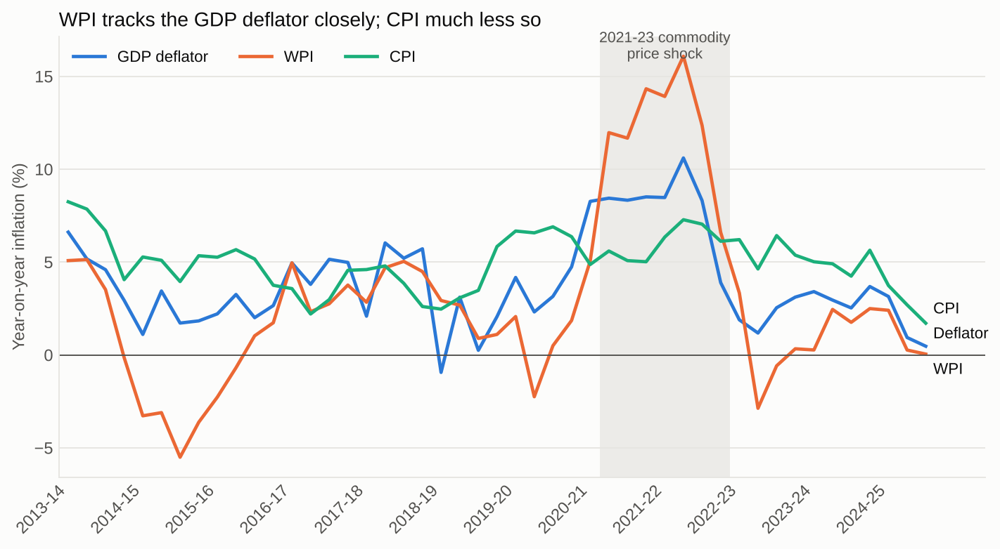
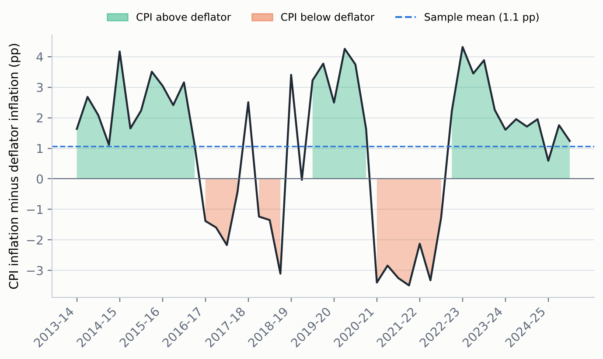
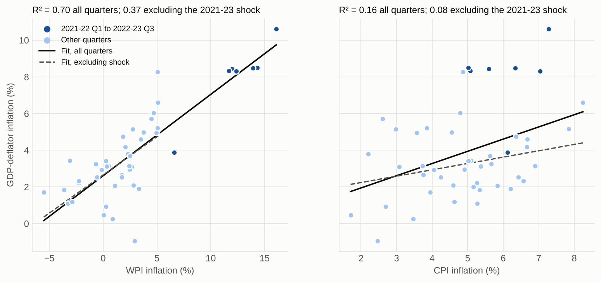
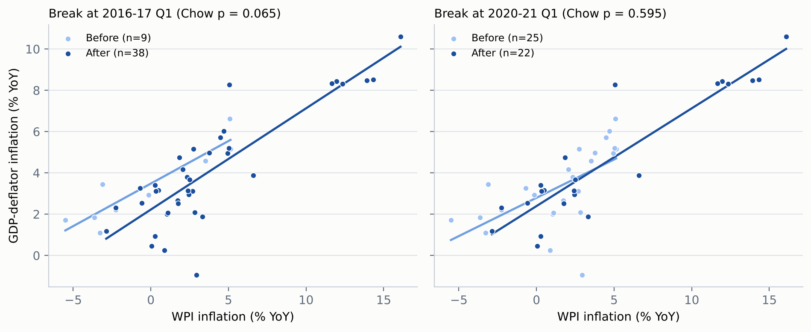
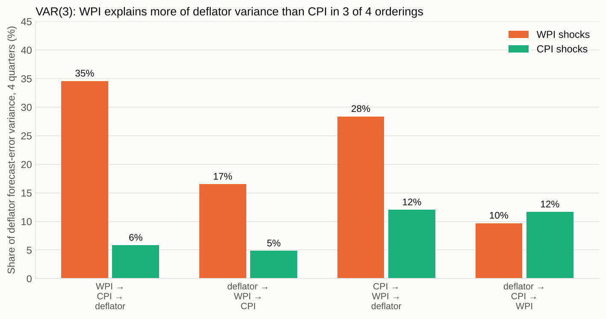

# India Inflation Analysis: CPI, WPI and the GDP Deflator

## Overview

If CPI inflation is around 4.5% while GDP-deflator inflation is around 2.5%, why is there such a large gap? Does it simply reflect the fact that these measures capture different things, or could the methodology behind the GDP deflator be producing a systematically different picture of inflation?

That question led me to explore the relationship between CPI, WPI and GDP-deflator inflation using quarterly Indian data. Three findings stood out:

- WPI inflation is much more closely associated with the GDP deflator than CPI inflation is (R² of 0.70 against 0.16).
- Most of that WPI fit comes from the 2021-23 commodity price shock. Without those quarters the R² falls to 0.37, but the slope stays at about 0.4.
- The gap between CPI and the deflator is not constant. It averages about +1.1 percentage points, but it changed sign during the 2021-23 shock.

This analysis establishes association, not causality.

## Research Question

**How closely are CPI and WPI inflation associated with GDP-deflator inflation in India?**

## Data

| Series | Definition |
|---|---|
| CPI inflation | Year-on-year change in the quarterly average Consumer Price Index |
| WPI inflation | Year-on-year change in the quarterly average Wholesale Price Index |
| GDP-deflator inflation | Year-on-year change in nominal GDP / real GDP × 100 |

- Quarterly data on Indian fiscal years (April to March), 2013-14 Q4 to 2025-26 Q2, giving 47 quarters.
- Source workbook: `Data/CPI_REGRESSON.xlsx`. I assume it holds the 2011-12 base national accounts series.
- All the constructed datasets and model results are compiled in one workbook, `India_Inflation_Datasets.xlsx` (see below).
- One data point needs checking at source: the deflator for 2018-19 Q4 shows about -0.94% year-on-year, which looks implausible and is the most influential observation in the baseline regression.

## Methodology

The baseline regressions use deflator inflation $\pi^D_t$ as the outcome and CPI inflation $\pi^C_t$ and WPI inflation $\pi^W_t$ as explanatory variables:

$$\pi^D_t = \alpha_1 + \beta_1 \pi^C_t + \varepsilon_t \qquad \text{(M1)}$$

$$\pi^D_t = \alpha_2 + \beta_2 \pi^W_t + \varepsilon_t \qquad \text{(M2)}$$

$$\pi^D_t = \alpha_3 + \beta_3 \pi^C_t + \gamma_3 \pi^W_t + \varepsilon_t \qquad \text{(M3)}$$

To check how much to trust them, I then:

1. ran residual diagnostics (Durbin-Watson, Breusch-Godfrey, Breusch-Pagan, RESET, Jarque-Bera, VIF, Cook's distance) and used Newey-West (HAC) standard errors;
2. tested for structural breaks with Chow tests;
3. re-estimated the models after removing the 2021-23 shock, before and after 2020-21, and without 2018-19 Q4;
4. compared candidate specifications on fit and on out-of-sample forecast error;
5. fitted a small VAR with Granger-causality tests and variance decompositions as an exploratory check.

## Key Results

### How large is the gap?

I define the gap as $g_t = \pi^C_t - \pi^D_t$.

| Statistic | Value |
|---|---|
| Mean gap | +1.06 pp |
| Quarters with CPI above the deflator | 68% |
| Quarters with a gap of 2 pp or more | 20 of 47 |
| Mean gap before 2020-21 | +1.3 pp |
| Mean gap in the 2021-23 shock quarters | -2.0 pp |
| Correlation of the gap with WPI inflation | -0.73 |

A gap of around two points is therefore not unusual in this sample, and its sign depends on where the commodity price cycle is.

### Baseline regressions

| | M1 (CPI) | M2 (WPI) | M3 (both) |
|---|---|---|---|
| CPI coefficient | 0.665 (p = 0.006) | | 0.331 (p = 0.017) |
| WPI coefficient | | 0.443 (p < 0.001) | 0.417 (p < 0.001) |
| R² | 0.156 | 0.703 | 0.740 |
| Durbin-Watson | 0.71 | 1.40 | 1.62 |

CPI and the GDP deflator do move together to some extent, and the relationship is statistically significant in my sample. However, the relationship is considerably stronger for WPI. WPI is significant at p < 0.001, compared with p ≈ 0.006 for CPI, and the WPI model has substantially greater explanatory power. Adding CPI to WPI raises R² only from 0.70 to 0.74.

This makes sense theoretically. Changes in wholesale and producer prices can affect the prices of domestically produced goods and services, which would ultimately affect the GDP deflator. This should not be interpreted as WPI causing the GDP deflator in a statistical sense. There are economic shocks and feedback mechanisms affecting both, and the old deflator was itself partly built from a WPI-based deflator, so my analysis establishes association rather than causality.

The CPI-only model (M1) is the weakest: its residuals are strongly autocorrelated (Durbin-Watson 0.71), so its coefficient should not be read as a stable relationship.

### How much is the 2021-23 shock?

| Sample | n | R² (WPI only) | WPI slope |
|---|---|---|---|
| Full sample | 47 | 0.703 | 0.443 |
| Excluding 2021-22 Q1 to 2022-23 Q3 | 40 | 0.374 | 0.416 |
| Before 2020-21 | 25 | 0.365 | 0.371 |
| 2020-21 onward | 22 | 0.835 | 0.473 |

The slope is stable (roughly 0.4), but the R² depends heavily on one episode. WPI inflation ranged from about -5.5% to +16%, so any positive relationship produces a high R².

### Structural break

I looked at possible breaks around 2016, when India moved to a formal inflation-targeting regime with a 4% CPI target and a 2-6% band, and 2020, which represents the global COVID-era economic shock.

$$F = \frac{(RSS_P - RSS_1 - RSS_2)/k}{(RSS_1 + RSS_2)/(n_1 + n_2 - 2k)}$$

| Break | F | p-value |
|---|---|---|
| 2016-17 Q1 | 2.91 | 0.0653 |
| 2020-21 Q1 | 0.53 | 0.595 |

There was some evidence of a change around 2016, but not strong enough to call it a definitive structural break (the Chow test was insignificant with a p-value of 0.0653). With only nine pre-break quarters the test has little power. The evidence around 2020 was considerably weaker.

### Best models

| Model | Equation | R² | Out-of-sample RMSE |
|---|---|---|---|
| M2: simplest | $\hat\pi^D_t = 2.61 + 0.443 \pi^W_t$ | 0.703 | 1.63 |
| M3: original | $\hat\pi^D_t = 1.04 + 0.331 \pi^C_t + 0.417 \pi^W_t$ | 0.740 | 1.58 |
| **C4: recommended** | $\hat\pi^D_t = 1.31 + 0.290 \pi^C_t + 0.577 \pi^W_t - 0.183 \pi^W_{t-1}$ | 0.765 | 1.51 |

C4 (CPI, WPI and one lag of WPI) has the best BIC among the candidate models without a dummy variable, clean residuals (Durbin-Watson 1.89), and the lowest forecast error (tied with one other specification). The negative lag means that part of a WPI jump reverses the following quarter, and the long-run WPI effect is $0.577 - 0.183 = 0.394$, close to the 0.44 from M2. The improvement is modest: forecast error falls by about 4% (1.58 to 1.51 percentage points) and I did not test whether that is statistically significant.

### VAR (exploratory)

I fitted a VAR(3) on annualised quarter-on-quarter seasonally adjusted rates with a COVID dummy. CPI never helps predict the deflator. WPI does at most lag lengths (p = 0.001 with three lags), but VAR(3) is the only lag length with clean residuals, and the variance decomposition depends on the ordering of the variables (WPI explains 10% to 35% of the deflator's four-quarter forecast error variance, CPI 5% to 12%). These results should not be quoted as precise, and Granger causality is about prediction, not cause and effect.

## Excel Workbook

`India_Inflation_Datasets.xlsx` compiles every constructed dataset and result table in one file:

| Sheet | Contents |
|---|---|
| `Data` | The 47-quarter dataset, the CPI-deflator gap, lagged WPI and period flags |
| `Gap_Summary` | Gap statistics and correlations (live formulas) |
| `Best_Models` | M2, M3 and C4 with OLS and HAC standard errors, fit and forecast error |
| `Models_M1_to_M8` | The original eight models, replicated |
| `Candidate_Models` | Seven specifications compared on fit and out-of-sample error |
| `Episode_Sensitivity` | R² and slopes with and without the 2021-23 shock |
| `Chow_Tests` | Structural break tests |
| `Relative_Importance` | Split of explained variance between CPI and WPI |
| `Unit_Roots_Cointegration` | ADF, KPSS, Johansen, Engle-Granger |
| `VAR_Granger`, `VAR_FEVD`, `VAR_Data` | VAR results and input series |
| `Rolling_Correlation`, `Lead_Lag` | Rolling and lead-lag correlations |
| `GDP_Levels` | Real and nominal GDP and price indices behind the deflator |

## Tools

R and Python (pandas, statsmodels, matplotlib). This repository holds the data, results and figures; the analysis scripts are not included.

## Limitations

- Small sample: 47 quarters with overlapping year-on-year changes, so tests have low power and results are sensitive to specification.
- The headline R² of 0.70 is driven largely by the 2021-23 commodity shock.
- Association, not causation. The deflator is a residual of nominal and real GDP and, in the old series, used a common WPI-based deflator.
- Nothing here tests the new 2022-23 base national accounts series.
- The 2018-19 Q4 deflator looks implausible and is influential.
- The unit-root tests are inconclusive in 47 observations, and the VAR results depend on lag length and variable ordering.
- Some of the literature I relied on consists of working papers, commentary and news reports.

## Conclusion

WPI inflation is closely associated with GDP-deflator inflation (slope of about 0.4, R² of 0.70), CPI inflation is weakly associated (R² of 0.16), and the strength of the WPI fit depends on the 2021-23 commodity shock. The gap between CPI and deflator inflation is large on average, highly variable, and tied to the wholesale price cycle. This analysis doesn't prove that the current GDP estimates are right or wrong. Instead, it made me more interested in the question of why the current gap between CPI, GDP and WPI looks so different from the historical relationship. One possible explanation could be the change in base year prices, but there isn't enough data yet to test that hypothesis.

I would appreciate feedback from people with experience in macroeconomics, national accounts or econometrics on how to establish causality between the two, and on other mechanisms that could explain the same pattern.
