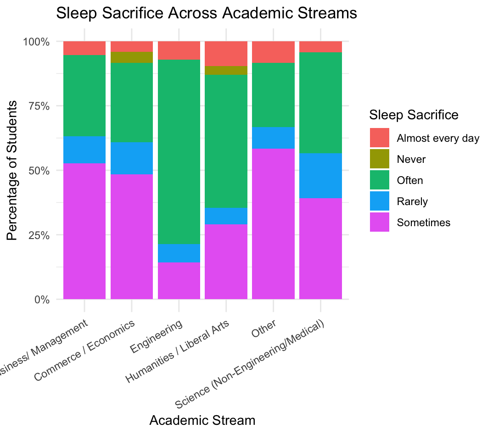

# Student Time Allocation, Sleep and Productivity

This project started from a simple question: do Delhi college students who carry heavier workloads give up more sleep, and what goes along with giving up sleep? It uses a survey of 219 students and ordinal logistic regression, since almost every variable in the survey is an ordered category (for example Never, Rarely, Sometimes, Often, Almost every day).

The short version of what the data show:

- Reported workload hours (academic, internship, extracurricular) do not predict how often students sacrifice sleep.
- Sleep sacrifice does differ by academic stream, mainly because Engineering and Humanities students report it more often. The Engineering group is small (14 students), so this is a tentative result.
- Students who sacrifice sleep more often also use stimulants (coffee, energy drinks and similar) more often. Each step up the sleep-sacrifice scale is associated with about twice the odds of being in a higher stimulant-use category (OR 2.0, 95% CI 1.5 to 2.7).

All of these are associations in a cross-sectional convenience sample. None of them is a causal estimate.

## Data

- 219 responses from college students in Delhi-NCR, collected through an online form.
- 160 respondents (73%) are from Delhi University. 120 (55%) study Commerce or Economics, 31 Humanities, 23 Science, 19 Business/Management, 14 Engineering and 12 other streams.
- Most are in their second or third year of undergraduate study (173 of 219).
- Variables are self-reported and banded: weekday and weekend sleep hours, sleep quality, how often sleep is sacrificed for work, stimulant use, weekly hours on academics, internships and extracurriculars, screen time, peer pressure, employment status and self-rated productivity after a short night.

Gender was an optional question and only 85 of 219 respondents answered it. The cleaning script fills the remaining 134 values with a k-nearest-neighbours imputation. With more than 60% of the values imputed, I do not treat gender as a reliable variable. The main results below are reported from models that leave it out, and they are the same in substance with it included.

## Method

Each model is a proportional-odds (ordinal) logit estimated with `MASS::polr` in R. Overall tests for each predictor are likelihood-ratio tests (`car::Anova`, Type II).

| Model | Outcome | Predictors |
| --- | --- | --- |
| 1 | Sleep sacrifice frequency | Extracurricular, internship and academic hours, screen time, employment, stream, year |
| 2 | Productivity after a short night | Weekday sleep, sleep sacrifice, stream |
| 3 | Stimulant use | Weekday sleep, sleep sacrifice, screen time |
| 4 | Sleep quality | Weekday sleep, academic hours, peer pressure |

A note on odds ratios. When an ordered factor is entered into `polr`, R reports polynomial contrasts (linear, quadratic and so on). The exponentiated "linear" term is not the odds ratio for moving up one category, and it can look very large. For the stimulant model it is 14.8, which is easy to misread as "15 times the odds". To get an odds ratio with a plain meaning, I re-estimated the key relationships with the predictor coded 1 to 5, which gives the odds ratio per one-step increase, and tested whether that linear coding fits worse than the unrestricted factor coding.

## Results

### 1. Workload hours do not predict sleep sacrifice, stream does

| Predictor | LR chi-square | df | p |
| --- | ---: | ---: | ---: |
| Academic hours | 2.40 | 4 | 0.66 |
| Internship hours | 1.40 | 4 | 0.84 |
| Extracurricular hours | 5.71 | 4 | 0.22 |
| Screen time | 6.07 | 4 | 0.19 |
| Employment | 3.40 | 3 | 0.33 |
| Year | 8.87 | 4 | 0.06 |
| Stream | 13.44 | 5 | 0.02 |

(Model 1 without imputed gender. With imputed gender included, stream has p = 0.003.)

Share reporting that they sacrifice sleep often or almost every day:

| Stream | n | Share |
| --- | ---: | ---: |
| Engineering | 14 | 79% |
| Humanities / Liberal Arts | 31 | 61% |
| Science | 23 | 43% |
| Business / Management | 19 | 37% |
| Commerce / Economics | 120 | 35% |
| Other | 12 | 33% |

Relative to Commerce/Economics, the odds of more frequent sleep sacrifice are higher for Engineering (OR 6.1, 95% CI 1.9 to 19.9) and Humanities (OR 2.7, 95% CI 1.2 to 6.3). The Engineering estimate moves a lot with the specification (from 4.5 with stream alone to 13.6 with imputed gender included), which is what one would expect from 14 observations. If the Engineering group is dropped, the stream effect is no longer significant (p = 0.21). I read this as evidence that stream matters more than reported hours in this sample, with the size of the Engineering difference left uncertain.



### 2. Sleep sacrifice and stimulant use

| Sleep sacrifice | n | Use stimulants often or daily |
| --- | ---: | ---: |
| Never | 6 | 0% |
| Rarely | 25 | 16% |
| Sometimes | 95 | 21% |
| Often | 81 | 37% |
| Almost every day | 12 | 58% |

Odds ratio for a higher stimulant-use category, per one-step increase in sleep sacrifice:

| Specification | OR | 95% CI |
| --- | ---: | ---: |
| Sleep sacrifice only | 2.07 | 1.53 to 2.82 |
| + weekday sleep, screen time (Model 3) | 1.97 | 1.45 to 2.69 |
| + stream, employment, year | 2.10 | 1.50 to 2.96 |

The estimate is stable across specifications (likelihood-ratio p < 0.001 in each). Coding sleep sacrifice as a 1 to 5 score does not fit worse than treating it as five separate categories (LR test p = 0.58), and a comparison with a multinomial logit does not reject the proportional-odds assumption (p = 0.90).

It is tempting to call this a coping effect, where students who lose sleep turn to caffeine. The data cannot separate that from the reverse direction (stimulant use making it easier or more likely to stay up) or from a common cause such as exam pressure. What the survey establishes is that the two go together.

### 3. Weekday sleep and sleep quality

Students who sleep more on weekdays report better sleep quality (OR 2.6 per step of weekday sleep, 95% CI 1.9 to 3.5). This is expected, and I mainly take it as a sign that the survey responses are internally consistent. Academic hours (p = 0.63) and peer pressure (p = 0.21) are not associated with sleep quality.

### 4. Productivity after a short night: no clear pattern

Weekday sleep is associated with self-rated productivity after a short night (LR chi-square 14.4, df 4, p = 0.006), but not in a simple direction. The share saying their productivity is worse after a short night is 20% among those sleeping under 4 hours (n = 10), 45% at 4 to 5 hours, 49% at 6 hours, 64% at 7 hours and 36% at 8 hours or more (n = 22). One reading is that students who usually sleep little have adapted to short nights, or at least believe they have. A quadratic term improves the fit (p = 0.015), but that result disappears when the 22 respondents sleeping 8 or more hours are left out (p = 0.70). I would not claim a non-linear relationship on this evidence.

### 5. Things that did not work

- Interaction terms add nothing reliable: extracurricular hours by stream (p = 0.44) and academic hours by employment (p = 0.12) are not significant, and the screen time by gender interaction is driven by a category with two respondents.
- A composite "time pressure" index built from the workload items has a Cronbach's alpha of 0.48, too low to use as a scale.

## Limitations

- Convenience sample, concentrated in Delhi University and in Commerce/Economics. The results describe these respondents, not Delhi students in general.
- Cross-sectional and self-reported. Direction of effect cannot be established, and reported hours may be noisy, which could be one reason workload shows no effect.
- Several groups are small (Engineering 14, under 4 hours of sleep 10, sleep sacrifice "Never" 6), so the estimates for them are imprecise.
- Many tests were run across the project (chi-square, Spearman, Kruskal-Wallis, four regressions) without a correction for multiple comparisons. Results near p = 0.05 should be read with that in mind. The stimulant result is far from that threshold. The stream result is closer to it.
- Gender is mostly imputed and is not used for inference.

## Files

| File | What it does |
| --- | --- |
| `code/student_time_allocation.R` | Cleaning, gender imputation, descriptive statistics, chi-square, Spearman and Kruskal-Wallis tests |
| `code/00_build_cleaned_df.R` | Rebuilds the analysis dataset from the cleaned Excel file |
| `code/part5to8_plain.R` | The four ordinal logit models, interactions, non-linearity checks and the composite index |
| `code/robustness_checks.R` | Per-step odds ratios, models without imputed gender, reference-group and small-cell checks, proportional-odds check |
| `output/` | Text output of the last two scripts |

The survey responses are not published here, to keep respondents' answers private. With the cleaned data file in the working folder, the results can be reproduced with:

```
Rscript code/00_build_cleaned_df.R Cleaned_Student_Time_Allocation_Data.xlsx cleaned_df.rds
Rscript code/part5to8_plain.R
Rscript code/robustness_checks.R
```

Packages: `MASS`, `car`, `psych`, `nnet`, `dplyr`, `readxl`.
